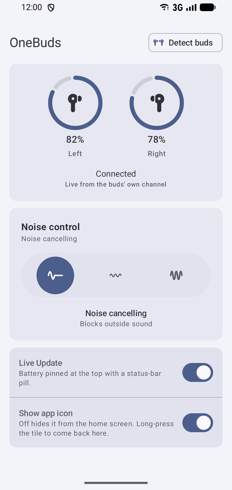
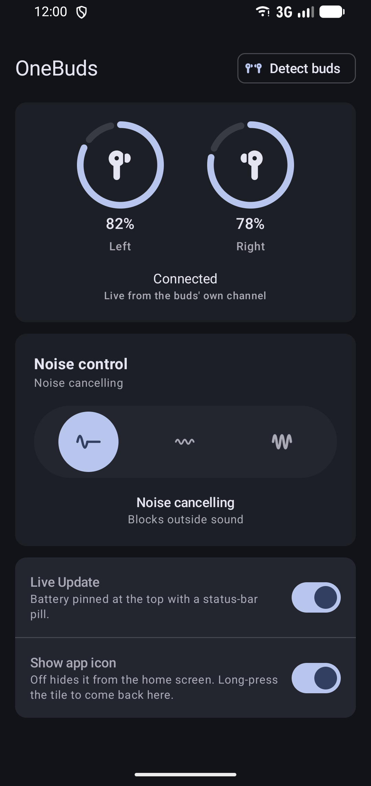
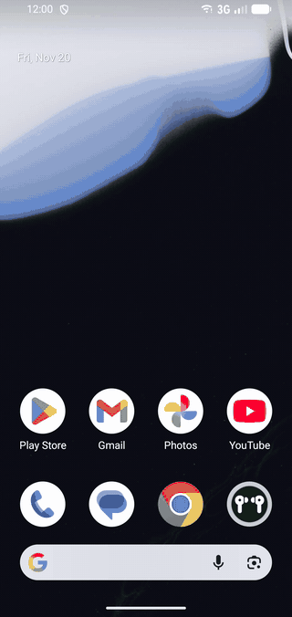

<div align="center">


# OneBuds

**Your Realme Buds T310 battery and noise control, right where you look.**

[](../../releases/latest)
[](../../releases)


### [⬇ Download the APK](../../releases/latest)

| Light | Dark | In action |
| :---: | :---: | :---: |
|  |  |  |

</div>

OneBuds shows your earbuds' battery and switches noise modes without opening the bulky official app. It wakes up on its own when the buds connect and goes quiet when they leave.

## Features

- **Battery at a glance**: left, right and case, with charging status
- **Live Update**: battery pinned to the top of the notification shade with a status-bar pill (Android 16)
- **Noise control**: switch Noise cancelling, Off or Transparency (aware) from the app, the notification or a widget
- **Home screen widgets**: battery, noise control, or both, from 1×1 to 4×2
- **Quick Settings tile**: one tap from the top of the screen
- **Hide the app icon** if you only use the tile and widgets
- **No internet permission.** The app talks only to your buds over Bluetooth. Nothing leaves your phone.

## Download

Get the latest APK from the **[Releases page](../../releases/latest)**, copy it to your phone and install it (allow "Install unknown apps" when asked).

## Requirements

- **Android 14 or newer** (it uses the companion-device presence feature added in Android 14)
- **Realme Buds T310** (other Realme buds on the same protocol may work, but are untested)

## Setup

1. Pair the buds in your phone's Bluetooth settings as usual.
2. Open OneBuds → **Allow** the Bluetooth and notification permissions.
3. Tap **Detect buds**, then **Link** your buds.
4. Done. Battery appears whenever the buds connect.

Optional: add the **Realme Buds** Quick Settings tile and a home screen widget.

## How it works

The buds speak a private Bluetooth protocol. OneBuds reads battery from the buds' Fast Pair broadcast and from their control channel, and sends noise-mode commands on the same channel. Android's companion-device feature wakes the app when the buds come in range, so nothing runs in the background while they're away.

Protocol notes: [docs/protocol/realme-link-tl-protocol.md](docs/protocol/realme-link-tl-protocol.md)

## Build from source

```bash
./gradlew assembleDebug     # debug APK in app/build/outputs/apk/debug/
./gradlew assembleRelease   # signed only if keystore.properties exists
./gradlew test              # unit tests
```

No buds at hand? Debug builds can fill in sample buds for screenshots:

```bash
adb shell am broadcast -n com.example.budsbattery/.DemoDataReceiver --es noise TRANSPARENCY
```

Release signing reads `keystore.properties` from the project root (git-ignored):

```properties
storeFile=/path/to/your.jks
storePassword=…
keyAlias=…
keyPassword=…
```

## Versions

Each release is a git tag (`v1.1.0`, `v1.2.0`, …) with its APK attached on the [Releases page](../../releases). The app's version lives in `app/build.gradle.kts` (`versionName`, `versionCode`).

## Built with

Kotlin · Jetpack Compose · Material 3 · Glance widgets · DataStore · Coroutines

---

Not affiliated with Realme. "Realme" is a trademark of its owner.
